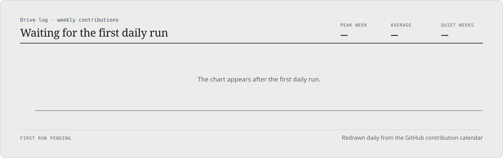

<picture>
  <source media="(max-width: 600px) and (prefers-color-scheme: dark)" srcset="assets/banner-phone-night.svg">
  <source media="(max-width: 600px)" srcset="assets/banner-phone-day.svg">
  <source media="(prefers-color-scheme: dark)" srcset="assets/banner-night.svg">
  
</picture>

**[Writing](https://sidkolapalli.com/)** · [Series](https://sidkolapalli.com/#/series) · [Work](https://sidkolapalli.com/#/work) · [About](https://sidkolapalli.com/#/about) · [RSS feed](https://sidkolapalli.com/feed.xml) · [LinkedIn](https://www.linkedin.com/in/sidkolapalli)

<picture>
  <source media="(prefers-color-scheme: dark)" srcset="assets/divider-night.svg">
  
</picture>

### About me

I’m a systems engineer in Michigan. I work where automotive systems engineering meets applied AI: simulation, model-based systems engineering, ADAS and powertrain.

A lot of what I build is about letting language models do real engineering work, with the boundaries kept outside the model. [carla-agentic-toolkit](https://github.com/sidkolapalli/carla-agentic-toolkit) is one example: a sandboxed MCP server that lets AI agents drive the CARLA simulator, then puts its settings back afterwards.

Every article on [sidkolapalli.com](https://sidkolapalli.com/) started as a problem I ran into on a project. I write them in plain words, with the evidence and its limits.

<table>
  <tr><th align="left">Role</th><td>Systems engineer</td></tr>
  <tr><th align="left">Based in</th><td>Michigan</td></tr>
  <tr><th align="left">Focus</th><td>Automotive systems · software engineering · AI tooling</td></tr>
  <tr><th align="left">Topics</th><td>Simulation · MBSE · ADAS · Powertrain · AI</td></tr>
  <tr><th align="left">Building</th><td><a href="https://github.com/sidkolapalli/carla-agentic-toolkit">carla-agentic-toolkit</a> · <a href="https://github.com/sidkolapalli/TracePad">TracePad</a></td></tr>
</table>

Principles: safety by design · evidence over opinion · simplicity first · repeatability

<picture>
  <source media="(prefers-color-scheme: dark)" srcset="assets/divider-night.svg">
  
</picture>

<!-- DRIVE-LOG:START -->
<picture>
  <source media="(max-width: 600px) and (prefers-color-scheme: dark)" srcset="assets/drive-log-phone-night.svg">
  <source media="(max-width: 600px)" srcset="assets/drive-log-phone-day.svg">
  <source media="(prefers-color-scheme: dark)" srcset="assets/drive-log-night.svg">
  
</picture>
<!-- DRIVE-LOG:END -->

<picture>
  <source media="(prefers-color-scheme: dark)" srcset="assets/divider-night.svg">
  
</picture>

### Writing

<!-- WRITING:START -->
- Agent Systems · [Why You Can’t Just Let an AI Run Your Driving Tests](https://sidkolapalli.com/#/post/carla-problem)
- Agent Systems · [I Gave an AI the Driving Simulator, Not the Keys to My Computer](https://sidkolapalli.com/#/post/carla)
- ADAS · [The AI Picks the Move. My Code Had Already Checked Every Option.](https://sidkolapalli.com/#/post/jev)
- ADAS · [Six Trials, One Fallback: What My AI Merge Experiment Actually Showed](https://sidkolapalli.com/#/post/jev-results)
- Simulation · [Why the Simulated Traffic Kept Vanishing Between AI Calls](https://sidkolapalli.com/#/post/traffic)
<!-- WRITING:END -->

[All articles on sidkolapalli.com →](https://sidkolapalli.com/)

<picture>
  <source media="(prefers-color-scheme: dark)" srcset="assets/divider-night.svg">
  
</picture>

### Selected work

**[carla-agentic-toolkit](https://github.com/sidkolapalli/carla-agentic-toolkit)** · Python 
Sandboxed MCP server that lets AI agents drive the CARLA simulator safely, with journaled cleanup and settings restoration.

**[TracePad](https://github.com/sidkolapalli/TracePad)** · TypeScript 
Local Python learning and interview practice workspace with visual reasoning, timed mocks, and optional MCP coaching.

<picture>
  <source media="(prefers-color-scheme: dark)" srcset="assets/divider-night.svg">
  
</picture>

### Toolbox

Python · TypeScript · Rust · Java · React · FastAPI · Linux · GitHub Actions

Simulation · MBSE · ADAS · MCP · agentic workflows · data systems

<picture>
  <source media="(prefers-color-scheme: dark)" srcset="assets/divider-night.svg">
  
</picture>

**New articles:** follow the [RSS feed](https://sidkolapalli.com/feed.xml) or visit [sidkolapalli.com](https://sidkolapalli.com/).

On open source I send focused fixes, tests, documentation and technical feedback.
