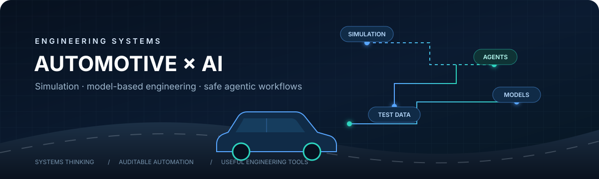
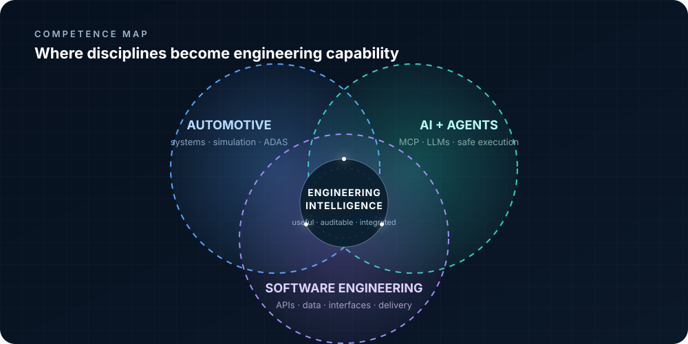

 

## Competence map

## Engineering focus

<table>
<tr>
<td width="50%" valign="top">

### Automotive intelligence

Practical AI-assisted workflows for complex engineering environments—with an emphasis on control, evidence, and human review.

</td>
<td width="50%" valign="top">

### Simulation and validation

Autonomous-driving systems, test environments, and the data loops that turn simulation results into engineering decisions.

</td>
</tr>
<tr>
<td width="50%" valign="top">

### Model-based engineering

Connecting systems models, architecture methods, and modern developer experiences without losing engineering rigor.

</td>
<td width="50%" valign="top">

### Agentic tooling

Carefully scoped interfaces that let AI systems operate technical tools while remaining observable and auditable.

</td>
</tr>
</table>

## Working layers

 

## Principles

> **Useful over flashy.** Build tools that reduce real engineering friction.

> **Evidence over magic.** Make automated work inspectable, testable, and reversible.

> **Systems over demos.** Design for the interfaces, constraints, and failure modes around the model.

## Open-source trajectory

Contributing focused fixes, tests, documentation, and technical feedback to engineering tools worth improving.

 

SIMULATION × SYSTEMS × INTELLIGENCE

